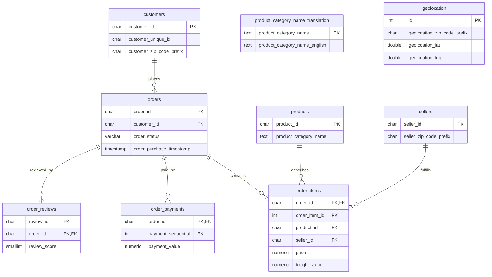

# Database Schema

## Layers

The project separates unchanged source tables, standardized analysis inputs,
and reporting interfaces:

```text
CSV source files
      │ schema/init.sh
      ▼
public (source/raw tables)
      │ sql/03_staging/02_refresh_staging.sql
      ▼
staging (typed tables, derived fields, quality flags)
      │ sql/07_views/*.sql
      ▼
analytics (reusable reporting views)
```

The source tables currently live in PostgreSQL's `public` schema; there is no
separate schema named `raw`. The source table DDL is
[schema/tables.sql](../schema/tables.sql), and the staging DDL is
[sql/03_staging/01_create_staging_tables.sql](../sql/03_staging/01_create_staging_tables.sql).

## Source tables and relationships



`order_items`, `order_payments`, and `order_reviews` use composite primary
keys. The raw schema enforces foreign keys from orders to customers, items to
orders/products/sellers, and payments/reviews to orders. Product-category
translation is a lookup join, not a declared foreign key. Geolocation rows
cannot be joined one-to-one to a customer or seller: ZIP prefixes repeat and
the source includes repeated records, so no foreign key is declared.

## Staging tables

The `staging` schema preserves source business keys while trimming fixed-width
identifiers, standardizing column names, and adding derived values and
quality flags:

| Table | Grain and key |
|---|---|
| `staging.customers` | One row per order-specific `customer_id`; `customer_unique_id` groups a person across orders. |
| `staging.product_category_translations` | One row per source category name. |
| `staging.sellers` | One row per `seller_id`. |
| `staging.geolocation` | One row per source surrogate `source_geolocation_id`; duplicate location observations are preserved. |
| `staging.products` | One row per `product_id`, with original and translated category values. |
| `staging.orders` | One row per `order_id`, including purchase month, delivery duration, and chronology/status flags. |
| `staging.order_items` | One row per (`order_id`, `order_item_id`), with price, freight, and item total. |
| `staging.order_payments` | One row per (`order_id`, `payment_sequential`). |
| `staging.order_reviews` | One row per (`review_id`, `order_id`); repeated review IDs across orders remain possible. |

Unlike the raw schema, the staged relations enforce their primary and foreign
keys. Suspicious source values are retained and exposed through flags; the
refresh does not silently repair them. See
[the staging-layer notes](staging_layer.md) for transformations and row counts.

## Analytics views

The `analytics` schema contains regular views over staging:

| View | Grain |
|---|---|
| `customer_summary` | One row per person-level `customer_unique_id`. |
| `product_summary` | One row per product. |
| `seller_summary` | One row per seller. |
| `monthly_revenue` | One row per purchase calendar month, including zero-sales months. |
| `customer_rfm` | One row per customer with a delivered order. |
| `customer_cohorts` | One row per cohort/activity month with observed activity. |
| `delivery_performance` | One row per delivered order. |
| `monthly_kpis` | One row per purchase calendar month. |
| `kpi_summary` | One row for the full-dataset snapshot. |

The views are defined in
[sql/07_views/01_create_analytics_views.sql](../sql/07_views/01_create_analytics_views.sql)
and [sql/07_views/02_create_kpi_summary.sql](../sql/07_views/02_create_kpi_summary.sql).
Their measure definitions and join-grain rules are in
[docs/methodology.md](methodology.md).
